# SciGraph-NLP

**Automated Scientific Knowledge Graph Construction using NLP and Deep Learning**

SciGraph-NLP extracts scientific entities and relations from abstracts and papers with
fine-tuned SciBERT models, resolves duplicate entities, and stores the resulting facts in a
Neo4j knowledge graph where every edge keeps its source sentence, confidence, model version
and validation status. The graph can be explored through parameterised Cypher queries,
multi-hop paths and NetworkX analytics, exported to RDF, and used through a FastAPI service
and a Streamlit interface.

## Contents

1. [Project Overview](#1-project-overview)
2. [Research Motivation](#2-research-motivation)
3. [Problem Definition](#3-problem-definition)
4. [Dataset](#4-dataset)
5. [System Architecture](#5-system-architecture)
6. [Data Preprocessing](#6-data-preprocessing)
7. [Named Entity Recognition](#7-named-entity-recognition)
8. [Relation Extraction](#8-relation-extraction)
9. [Knowledge Graph Construction](#9-knowledge-graph-construction)
10. [Knowledge Representation](#10-knowledge-representation)
11. [Graph Querying](#11-graph-querying)
12. [Experimental Setup](#12-experimental-setup)
13. [Results](#13-results)
14. [Installation](#14-installation)
15. [Training](#15-training)
16. [Inference](#16-inference)
17. [Application Demo](#17-application-demo)
18. [Reproducibility](#18-reproducibility)
19. [Limitations](#19-limitations)
20. [Future Work](#20-future-work)
21. [References](#21-references)

## 1. Project Overview

| Stage | Implementation |
|---|---|
| Entity recognition | Span classification on SciBERT, nested entities supported |
| Relation extraction | SciBERT with typed entity markers, directional, with a no-relation class |
| Baseline | spaCy noun chunks with lexical type rules and relation patterns |
| Entity resolution | Type-aware normalised keys, acronym resolution, candidate-duplicate report |
| Storage | Neo4j 5 (constraints, indexes, batched idempotent ingestion, provenance) |
| Knowledge representation | RDFS/OWL ontology, Turtle export with RDFLib, SPARQL, SHACL |
| Exploration | Named Cypher queries, bounded multi-hop paths, NetworkX centrality and communities |
| Interfaces | FastAPI (validated inputs), Streamlit (six pages), CLI |
| Engineering | pytest, Ruff, Docker, docker-compose with Neo4j, GitHub Actions |

## 2. Research Motivation

The scientific literature grows faster than anyone can read it, and the knowledge it contains
(which method addresses which task, on which dataset, measured with which metric) is locked
in unstructured text. Turning this text into a graph of typed, linked and traceable facts
makes it searchable by structure: one can ask which methods have been used for a task, how
two concepts are connected, or which documents support a claim. Doing so automatically
requires reliable information extraction, and doing so *usefully* requires that the graph
keeps track of where each fact came from and how certain it is.

## 3. Problem Definition

Input: a scientific text (abstract or PDF with a text layer).
Output: a set of triples `(subject, predicate, object)` over typed entities, inserted into a
graph with provenance.

1. **Entity recognition.** Find all spans of the text that denote scientific entities and
   assign each one of six types: Task, Method, Metric, Material, OtherScientificTerm, Generic.
   Spans may be nested.
2. **Relation extraction.** For every ordered pair of entities in a sentence, predict one of
   USED-FOR, FEATURE-OF, HYPONYM-OF, PART-OF, COMPARE, CONJUNCTION, EVALUATE-FOR, or no
   relation.
3. **Graph construction.** Normalise and resolve entity mentions, aggregate triples, keep
   evidence, and separate predicted from verified knowledge.
4. **Exploitation.** Query, traverse and analyse the graph without presenting indirect
   associations as established relations.

The label inventory is that of SciERC; illustrative examples in this README are not
annotations.

## 4. Dataset

SciERC (Luan et al., 2018): 500 AI abstracts with entities, relations and coreference.
Official splits are used without modification. Full details, including the licence
situation, are in [docs/DATASET.md](docs/DATASET.md).

| | train | dev | test |
|---|---:|---:|---:|
| Documents | 350 | 50 | 100 |
| Sentences | 1,861 | 275 | 551 |
| Entities | 5,598 | 811 | 1,685 |
| Relations | 3,219 | 455 | 974 |
| Candidate entity pairs | 16,872 | 2,488 | 5,062 |

* All relations are within one sentence; 81 % of candidate pairs carry no relation.
* 99.3 % of entities span at most 8 tokens; 61 nested entity pairs in train, none crossing.
* USED-FOR accounts for 52.5 % of training relations; Metric for 4.1 % of entities.
* The release states no licence, so this repository does not redistribute it; a script
  downloads it from the official page and checks its SHA-256.

## 5. System Architecture

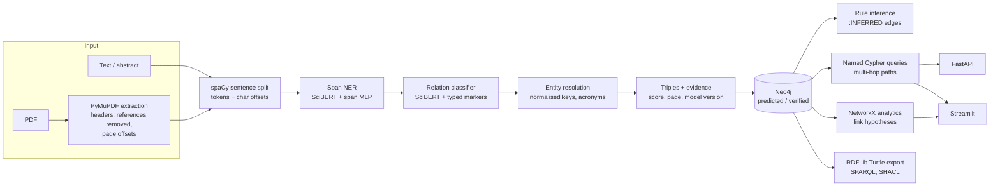

Source layout (details in [PROJECT_GUIDE.md](PROJECT_GUIDE.md)):

```
src/scigraph/
  data/          SciERC loading, validation, statistics
  baseline/      spaCy rule baseline
  models/        span NER, relation classifier, sub-word alignment
  training/      resumable training loops
  evaluation/    metrics
  pipeline/      text and PDF ingestion, extractors, normalisation, graph builder
  graph/         Neo4j store, queries, reasoning, analytics, RDF export
  api/           FastAPI application
  resources/     ontology and SHACL shapes
app/             Streamlit interface
configs/         training and graph settings
scripts/         data, baseline, experiments, reports
notebooks/       01-04, generated by scripts/build_notebooks.py
tests/           unit and integration tests
```

## 6. Data Preprocessing

* Document-level offsets (inclusive ends) are converted to sentence-local offsets; the
  conversion raises an error on any span crossing a sentence, unknown label, or relation
  whose argument is not an entity. None occur in the release.
* Document keys are checked for overlap between splits (none).
* Words are tokenised by WordPiece individually; the first and last sub-token of each word
  are recorded so that spans are always defined on words, never on sub-tokens.
* NER candidates: all spans of up to 8 words. 41 training entities (0.73 %) are longer and
  therefore unreachable; they are reported, not dropped from evaluation.
* RE candidates: all ordered pairs of distinct entities in a sentence. Symmetric gold
  relations are added in both directions for training only.
* New text: soft hyphens and hyphenated line breaks are repaired, sentences are split with
  spaCy, and every token keeps its character offset in the document. Sentences longer than
  120 tokens (tables, reference lists) are cut into chunks.

## 7. Named Entity Recognition

`src/scigraph/models/span_ner.py`

* Encoder: `allenai/scibert_scivocab_uncased`.
* Span representation: `[h_first(i); h_last(j); w(j-i+1)]`, width embedding of size 150.
* Classifier: two hidden layers of 150 units with ReLU and dropout 0.2, 7 outputs.
* Loss: cross-entropy over all enumerated spans.
* Decoding: every span with a non-`O` arg-max is kept, so nested entities can be output; a
  greedy non-overlapping decoder is available.
* Optimisation: AdamW, encoder learning rate 3e-5, head 5e-4, linear warm-up (10 %) and
  decay, batch size 16, gradient clipping 1.0, weight decay 0.01, seed 42.

Why not BIO tagging: SciERC contains nested entities, and a token-level tagger can encode
only one label per token. Span classification represents them natively at a cost that is
linear in sentence length for a fixed maximum width.

## 8. Relation Extraction

`src/scigraph/models/relation.py`

* Input: the sentence with typed markers around the candidate pair, for example
  `[CLS] we use <S:Method> crf </S:Method> for <O:Task> ner </O:Task> . [SEP]`.
* Representation: concatenated encoder states of the two opening markers, layer
  normalisation, linear layer over 8 classes (7 relations + `NO-RELATION`).
* Direction: (A, B) and (B, A) are distinct instances. COMPARE and CONJUNCTION are
  symmetric: trained in both directions, merged at inference.
* Negatives: the CPU configuration samples 1.5 negative pairs per positive, redrawn every
  epoch; evaluation scores all pairs.
* Optimisation: AdamW, encoder 3e-5, head 1e-4, batch size 32, 5 epochs (CPU configuration).

Experiment A uses gold entities as candidates, Experiment B the NER predictions. Relations
are scored with two criteria: *boundaries* (argument spans and label correct) and *strict*
(argument types also correct).

## 9. Knowledge Graph Construction

* **Normalisation**: NFKC, lower case, hyphen spacing, leading determiners removed, last word
  singularised, trailing acronym definition removed when it matches the long form.
* **Entity resolution**: same type and same normalised key, nothing else. Acronyms defined in
  a document resolve to their long form in that document. Generic mentions are never merged;
  bare head nouns ("method", "model") merge only within a document. Same-type pairs with
  token Jaccard >= 0.75 are listed as candidate duplicates for review, not merged.
* **Triples**: aggregated per (head entity, relation, tail entity) with support (number of
  documents), maximum score, and evidence (document, sentence, page, model version).
* **Neo4j model**: `Document -HAS_MENTION-> Mention -REFERS_TO-> Entity`, and one
  relationship type per SciERC relation between entities. Uniqueness constraints on all
  identifiers, indexes on key, type, status, and a full-text index on names. Ingestion uses
  `UNWIND` batches of 500 rows in managed transactions and is idempotent.
* **Knowledge layers**: `predicted` (model output), `verified` (gold annotations or human
  review through the API or UI), `:INFERRED` edges produced by named rules (hyponym and
  part-of transitivity, conjunction symmetry) from verified premises, and *hypotheses*
  (unlinked pairs ranked by shared neighbours) that are computed on demand and never stored.
  A prediction never downgrades a verified edge.

## 10. Knowledge Representation

* Ontology `src/scigraph/resources/scigraph.ttl`: six classes under `sg:ScientificEntity`,
  seven object properties (COMPARE and CONJUNCTION as `owl:SymmetricProperty`), disjointness
  between Task, Method, Metric and Material, and an `sg:Assertion` class for reified facts.
* Export: each fact becomes a direct triple (`sg:usedFor`, ...) and a reified assertion with
  `sg:confidence`, `sg:support`, `sg:status` and `prov:wasDerivedFrom`.
* SPARQL examples in `src/scigraph/graph/rdf_export.py` (methods used for tasks, metrics per
  task, high-confidence assertions, two-hop chains).
* SHACL shapes `src/scigraph/resources/shapes.ttl` check assertion structure, value ranges
  and provenance; EVALUATE-FOR assertions whose subject is not a Metric or Material are
  reported as warnings.

Neo4j is the operational store because relationship properties and traversals are native
there; RDF is the interchange format because it has global identifiers and standard
semantics. The two are kept consistent by generating RDF from the graph, not maintaining two
stores.

## 11. Graph Querying

All queries are named and parameterised (`src/scigraph/graph/queries.py`); free-form Cypher
is not accepted. Parameters are validated for type, range, length and allowed values, and
full-text input is Lucene-escaped.

| Query | Question |
|---|---|
| `search_entities` | Which entities match this text? |
| `entity_neighbors` | What is directly related to this entity? |
| `methods_for_task`, `metrics_for_task`, `datasets_for_task` | Which methods, metrics, materials relate to a task? |
| `concepts_for_method` | Which concepts are associated with a method? |
| `relations_between` | How are two entities directly related? |
| `relation_evidence`, `entity_provenance` | Which documents and sentences support this? |
| `frequent_pairs`, `top_entities` | Which concepts are most frequently connected? |
| `inferred_relations`, `review_queue`, `relation_statistics` | Inference layer, review, statistics |
| `find_paths`, `khop_neighbourhood` | Multi-hop paths (1 to 5 hops) and neighbourhoods |

Example (Cypher of `methods_for_task`):

```cypher
MATCH (m:Entity {type: 'Method'})-[r:USED_FOR]->(t:Entity {type: 'Task'})
WHERE toLower(t.name) CONTAINS toLower($task) AND r.status IN $statuses
RETURN m.name AS method, t.name AS task, r.score AS score, r.support AS support
ORDER BY r.support DESC, r.score DESC LIMIT $limit
```

NetworkX (`src/scigraph/graph/analytics.py`) provides degree, PageRank and betweenness
centrality, connected components, greedy-modularity communities, shortest paths, and
Adamic-Adar link hypotheses.

## 12. Experimental Setup

| Experiment | Protocol | Script |
|---|---|---|
| 1. NER | Baseline vs SciBERT span model, test split, exact span and type match, micro and macro F1 | `run_baseline.py`, `train_ner` |
| 2. RE | Relation classifier on gold entities (Experiment A), boundaries and strict criteria | `train_re` |
| 3. End to end | Relations from predicted entities (Experiment B) | `train_re`, `predict_scierc.py` |
| 4. Graph quality | Gold vs predicted graph of the 100 test documents after resolution: fact-level P/R/F1, duplicates, type signatures unseen in training, SHACL, provenance coverage | `evaluate_graph.py` |
| 5. Graph querying | Cypher answers vs reference answers from gold annotations and NetworkX, latency | `evaluate_queries.py` |
| 6. Performance | Inference and graph construction time on fixed inputs | `benchmark.py` |

Model selection uses the dev split only; the test split is evaluated once with the best dev
checkpoint. Hardware: CPU only (8 cores, 16 GB RAM, Windows 11, PyTorch 2.14 CPU build).

<!-- RESULTS:START -->
## 13. Results

All numbers below were produced by the runs described in section 12 and are stored in
`reports/metrics/`. They come from a single training run per model (seed 42) with the CPU
configuration, so no variance estimate is available. Scores are on the official SciERC test
split (100 abstracts, 551 sentences, 1,685 entities, 974 relations) with the best dev
checkpoint. No comparison with published systems is claimed, because configuration and
compute differ.

### Experiment 1: named entity recognition

Exact match of boundaries and type.

| System | Precision | Recall | Micro-F1 | Macro-F1 |
|---|---:|---:|---:|---:|
| Rule baseline (spaCy noun chunks + lexicons) | 21.03 | 37.45 | 26.94 | 27.41 |
| SciBERT span classifier | 67.02 | 67.06 | **67.04** | 66.43 |

* Dev micro-F1 of the selected checkpoint (epoch 10 of 10): 70.92.
* Ignoring the type (boundaries only), test F1 is 79.15: about 12 points are lost to type
  confusions, mostly OtherScientificTerm vs Method and Method vs Task.
* Per type (test F1): Method 75.42, Generic 71.54, Metric 64.52, Task 63.36,
  OtherScientificTerm 62.05, Material 61.69.
* Nested entities: of the 20 nested gold pairs in test, 3 are recovered entirely. The model
  outputs 81 overlapping pairs, of which 3 are fully correct. Decoding without overlap
  (`scripts/ner_decoding_ablation.py`) gives 71.24 dev / 67.29 test micro-F1, against
  70.92 / 67.04 for nested decoding. The difference is small for a single run; nested
  decoding is kept as configured before evaluation, and the decoder is a setting in
  `configs/graph.yaml`.

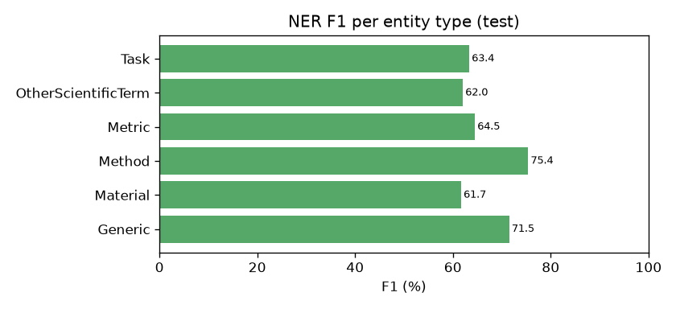

### Experiment 2: relation extraction on gold entities (Experiment A)

| System | Precision | Recall | Micro-F1 | Macro-F1 |
|---|---:|---:|---:|---:|
| Rule baseline (lexical patterns) | 67.65 | 16.53 | 26.57 | 18.50 |
| SciBERT typed-marker classifier | 67.29 | 73.51 | **70.26** | 67.07 |

Dev micro-F1 of the selected checkpoint (epoch 4 of 5): 71.27. With gold entities the strict
and boundaries criteria coincide.

| Relation | P | R | F1 | Gold |
|---|---:|---:|---:|---:|
| CONJUNCTION | 79.70 | 86.18 | 82.81 | 123 |
| HYPONYM-OF | 75.95 | 89.55 | 82.19 | 67 |
| COMPARE | 74.42 | 84.21 | 79.01 | 38 |
| USED-FOR | 68.98 | 74.67 | 71.71 | 533 |
| EVALUATE-FOR | 58.26 | 73.63 | 65.05 | 91 |
| PART-OF | 61.11 | 34.92 | 44.44 | 63 |
| FEATURE-OF | 38.27 | 52.54 | 44.29 | 59 |

Recall exceeds precision for most types, consistent with training on a subsample of
negative pairs. The largest confusion is between USED-FOR and no relation in both directions
(142 pairs without a relation predicted as USED-FOR, 98 USED-FOR pairs missed).

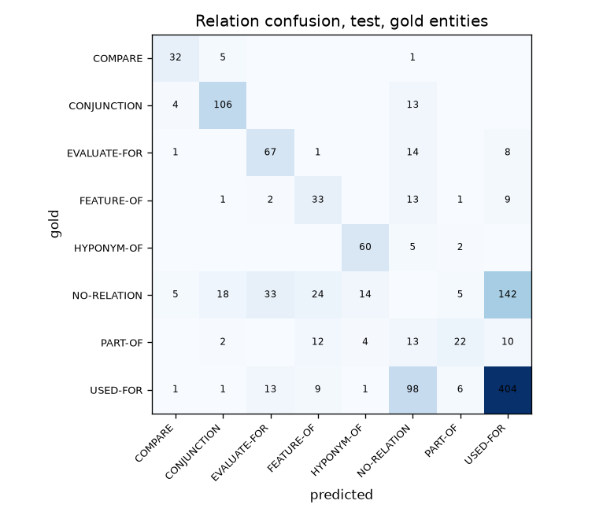

### Experiment 3: end-to-end extraction (Experiment B)

Relations predicted on the entities predicted by the NER model.

| System | Criterion | Precision | Recall | Micro-F1 | Macro-F1 |
|---|---|---:|---:|---:|---:|
| Rule baseline | boundaries | 12.22 | 8.32 | 9.90 | 6.79 |
| Rule baseline | strict | 6.18 | 4.21 | 5.01 | 3.96 |
| SciBERT NER + RE | boundaries | 45.29 | 50.31 | **47.67** | 45.90 |
| SciBERT NER + RE | strict | 33.18 | 36.86 | **34.92** | 35.28 |

Error propagation: relation F1 drops from 70.26 with gold entities to 47.67 with predicted
entities. Of the 974 gold test relations, 490 are found; 311 are missed because NER did not
find one of the two arguments with exact boundaries, 108 because the pair was classified as
no relation, 40 receive a wrong label and 25 the wrong direction (notebook
`04_evaluation.ipynb`). The further drop from boundaries to strict (12.75 points) comes
from argument type errors. Running the pipeline again from the saved models
(`scripts/predict_scierc.py`) reproduces these scores exactly.

### Experiment 4: knowledge graph quality

Graphs of the 100 test documents built from gold annotations and from end-to-end
predictions, after normalisation and entity resolution (`reports/metrics/graph_quality.json`).

| | Gold graph | Predicted graph |
|---|---:|---:|
| Mentions / entities | 1,685 / 1,488 | 1,686 / 1,517 |
| Entities linked across documents | 33 | 32 |
| Triples | 970 | 1,073 |
| Candidate duplicate pairs (reported, not merged) | 7 | 11 |
| Self-loops | 0 | 0 |
| Triples with evidence sentence | 100 % | 100 % |
| SHACL violations / warnings | 0 / 18 | 0 / 27 |

* Document-level fact precision / recall / F1 of the predicted graph against the gold graph:
  33.27 / 36.88 / 34.98 with entity types, 44.45 / 49.28 / 46.74 without. These are close to
  the sentence-level strict and boundaries scores, as expected when entity resolution is
  conservative.
* 24 predicted triples (2.24 %) have a (head type, relation, tail type) signature never seen
  in the training annotations, for example `Task HYPONYM-OF OtherScientificTerm`.
* The 18 SHACL warnings on the gold graph are gold EVALUATE-FOR assertions whose subject is
  neither a Metric nor a Material: the constraint reflects the guideline, not the data.

### Experiment 5: graph querying

The gold test graph was loaded into Neo4j 5.26 and each query compared with reference
answers derived from the gold annotations and from NetworkX (`scripts/evaluate_queries.py`,
50 random cases per check, seed 13).

| Check | Passed | Median / p95 latency (ms) |
|---|---:|---:|
| `methods_for_task` returns the annotated method | 50 / 50 | 8.1 / 20.1 |
| `entity_neighbors` equals the NetworkX neighbourhood | 50 / 50 | 6.4 / 9.4 |
| Shortest path length equals NetworkX (2 to 4 hops) | 50 / 50 | 5.9 / 6.8 |
| No path between different components | 50 / 50 | - |
| `relation_evidence` returns the source documents | 50 / 50 | 7.9 / 11.1 |

Latency is client-side on a local single-instance database holding about 1,500 entities; it
says nothing about behaviour at scale.

### Experiment 6: performance

CPU only (8 logical cores, PyTorch using 4 threads), median of 3 runs, model loading
excluded (`reports/metrics/performance.json`).

| Step | Input | Time |
|---|---|---:|
| NER | 551 test sentences | 42.3 s (76.8 ms per sentence) |
| RE | 5,238 candidate pairs | 335.7 s (64.1 ms per pair) |
| Full pipeline | one sample abstract (4 sentences) | 1.82 s |
| Graph construction | test predictions (1,517 entities, 1,073 triples) | 0.23 s |
| Neo4j ingestion | same graph, 100 documents, 1,686 mentions | 1.08 s |

Relation extraction dominates because each candidate pair is encoded separately (one
encoder pass per pair). Training took about 1 h 54 min for NER (10 epochs) and 6 h 15 min
for RE (5 epochs); RE training was slowed by memory pressure on the machine.

### Training curves

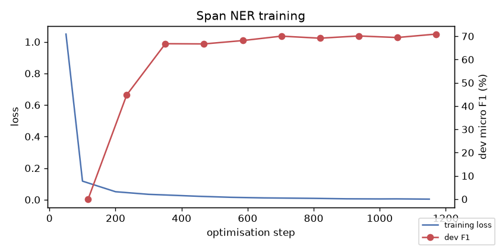
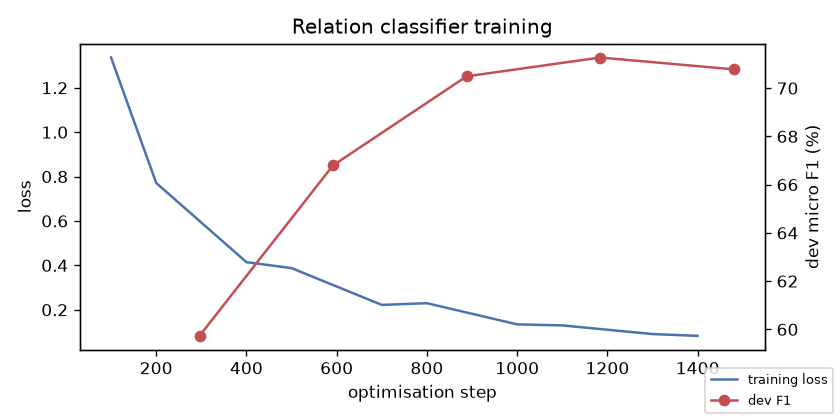
<!-- RESULTS:END -->

## 14. Installation

Tested on Windows 11 with Python 3.11 (Git Bash commands shown; on Linux or macOS use
`.venv/bin/python`).

```bash
py -3.11 -m venv .venv
```

```bash
.venv/Scripts/python -m pip install torch --index-url https://download.pytorch.org/whl/cpu
```

```bash
.venv/Scripts/python -m pip install -e ".[ui,shacl,dev]"
```

```bash
.venv/Scripts/python -m spacy download en_core_web_sm
```

Data (downloads about 695 MB and keeps the three JSON files):

```bash
.venv/Scripts/python scripts/download_scierc.py --out data/raw/scierc
```

```bash
.venv/Scripts/python scripts/prepare_data.py
```

### Neo4j

Any Neo4j 5 instance works. Without Docker, the Community Edition archive runs with Java 21:
download `neo4j-community-5.26.12-windows.zip` from https://neo4j.com/deployment-center/,
unzip it into `neo4j/` (git-ignored), set a password and start it:

```bash
neo4j/neo4j-community-5.26.12/bin/neo4j-admin.bat dbms set-initial-password "<password>"
```

```bash
neo4j/neo4j-community-5.26.12/bin/neo4j.bat console
```

Then copy `.env.example` to `.env` and set `NEO4J_PASSWORD`. With Docker, `docker compose up`
starts Neo4j together with the API and the UI (see section 17).

## 15. Training

CPU configuration (the one used for the reported results):

```bash
.venv/Scripts/python -m scigraph.training.train_ner --config configs/ner_cpu.yaml
```

```bash
.venv/Scripts/python -m scigraph.training.train_re --config configs/re_cpu.yaml
```

GPU configuration (cross-sentence context, all negative pairs; provided, not run here):
`configs/ner.yaml` and `configs/re.yaml`, or the notebooks `02_train_scibert_ner.ipynb` and
`03_train_relation_extraction.ipynb` on Kaggle or Colab. Any parameter can be overridden,
for example `--set epochs=3 gradient_accumulation=2`.

Re-running a command with the same `output_dir` resumes from `checkpoints/last.pt`. The best
dev checkpoint is exported to `<output_dir>/best/`. Afterwards:

```bash
.venv/Scripts/python scripts/make_report.py
```

## 16. Inference

The API and the CLI look for trained models in `models/ner` and `models/re` (override with
`SCIGRAPH_NER_DIR`, `SCIGRAPH_RE_DIR`); without them they fall back to the rule baseline and
report `extractor: rule-baseline`.

```bash
mkdir -p models && cp -r outputs/ner/best models/ner && cp -r outputs/re/best models/re
```

```bash
.venv/Scripts/scigraph extract data/samples/abstract_1.txt --out extraction.json
```

```bash
.venv/Scripts/scigraph ingest data/samples
```

```bash
.venv/Scripts/scigraph ingest-gold --split test
```

```bash
.venv/Scripts/scigraph export-ttl graph.ttl
```

API:

```bash
.venv/Scripts/python -m uvicorn scigraph.api.main:app --port 8000
```

| Method | Endpoint | Purpose |
|---|---|---|
| GET | `/health` | Extractor in use, Neo4j connectivity |
| POST | `/extract` | Entities, relations and triples for a text (max 20,000 characters) |
| POST | `/extract/pdf` | Same for a PDF upload (max 15 MB, text layer required) |
| POST | `/graph/ingest` | Extract and store as predicted knowledge |
| GET | `/graph/queries` | Catalogue of named queries and their parameters |
| POST | `/graph/query` | Run a named query with validated parameters |
| GET | `/graph/paths` | Shortest paths between two entities (1 to 5 hops) |
| GET | `/graph/neighbourhood/{id}` | Edges within 1 to 3 hops |
| POST | `/graph/relations/{id}/review` | Mark a relation verified or rejected |
| POST | `/graph/infer`, GET `/graph/inferred` | Apply and list rule inferences |
| GET | `/graph/hypotheses` | Link hypotheses (not facts) |
| GET | `/graph/analytics`, `/graph/stats` | NetworkX analytics, counts |
| GET | `/graph/export.ttl` | Turtle export |

Interactive documentation is served at `/docs`.

## 17. Application Demo

```bash
.venv/Scripts/python -m streamlit run app/streamlit_app.py
```

Pages: Document Analysis (entities), Relation Extraction (relations and triples), Knowledge
Graph (filtered visualisation, centrality, communities), Graph Exploration (neighbourhoods,
multi-hop paths, review queue), Scientific Queries (named queries, evidence, inferred
relations, hypotheses), Model Evaluation (measured metrics and figures). Inputs can be
pre-filled from the URL, for example `/?sample=1`, `/exploration?explore=crf` or
`/queries?query=methods_for_task&task=translation&run=1`.

The screenshots below were captured from the running app with the trained models and the
demonstration graph (SciERC test predictions, SciERC test gold annotations as verified
knowledge, the three sample abstracts) using `scripts/capture_screenshots.py`.

| | |
|---|---|
| 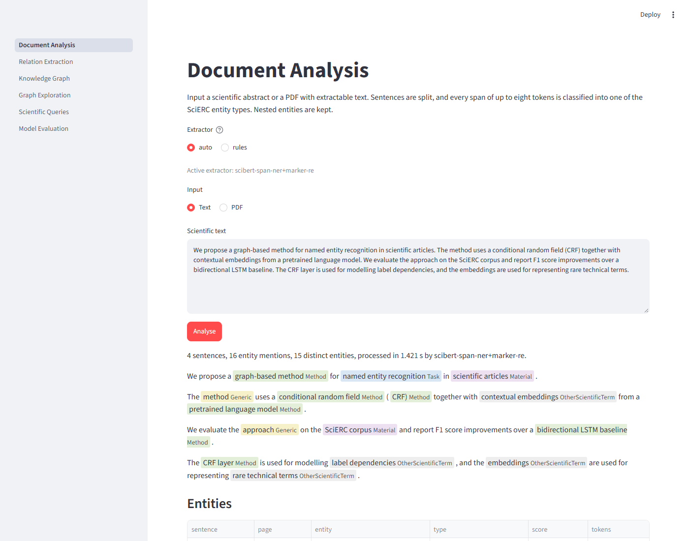 | 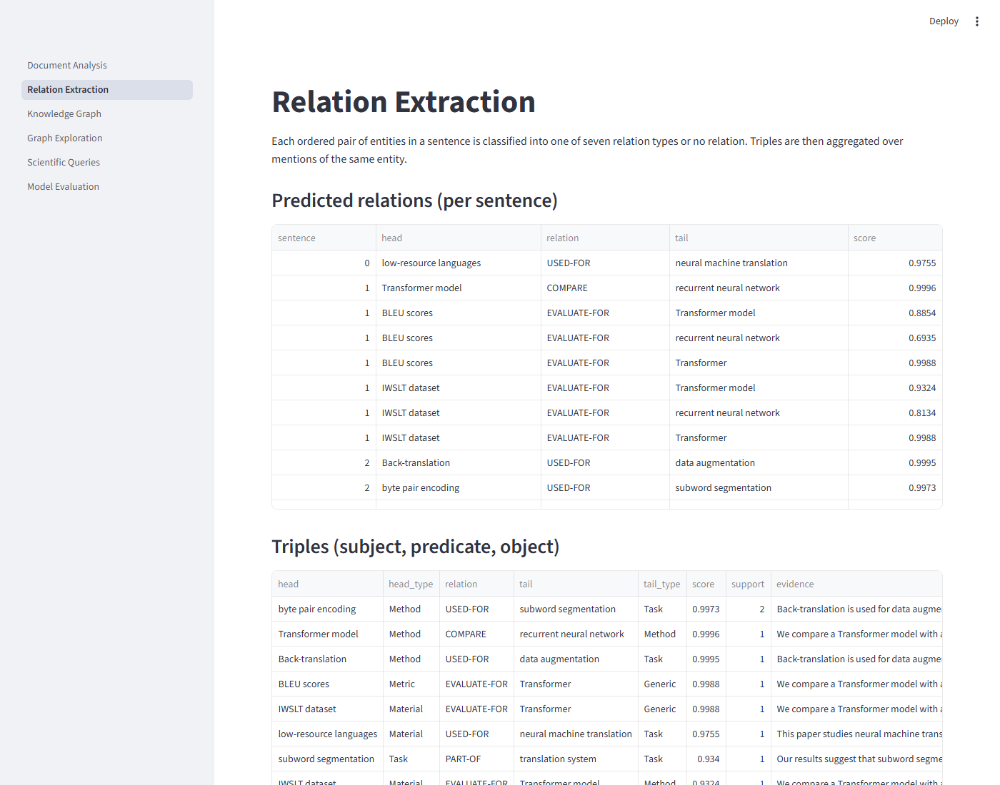 |
| 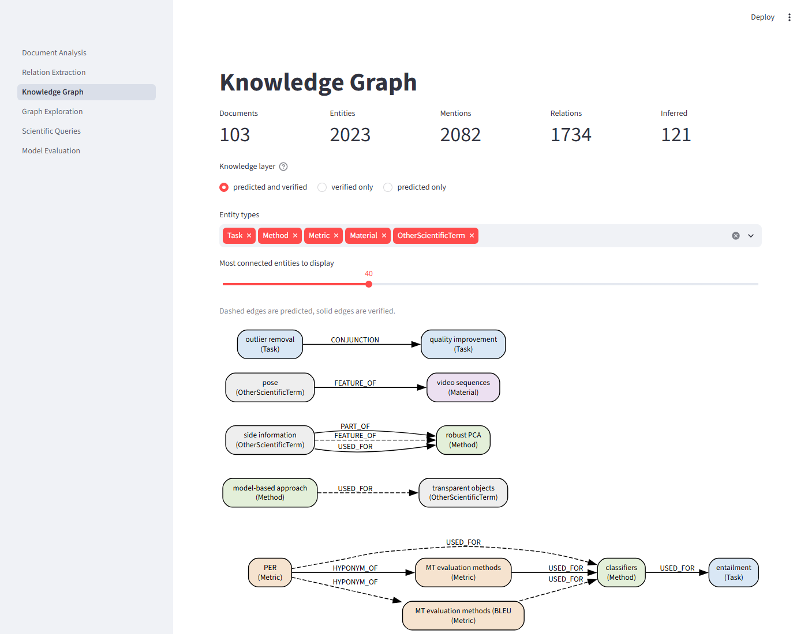 | 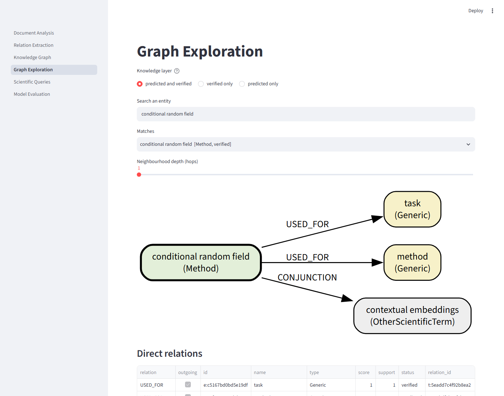 |
| 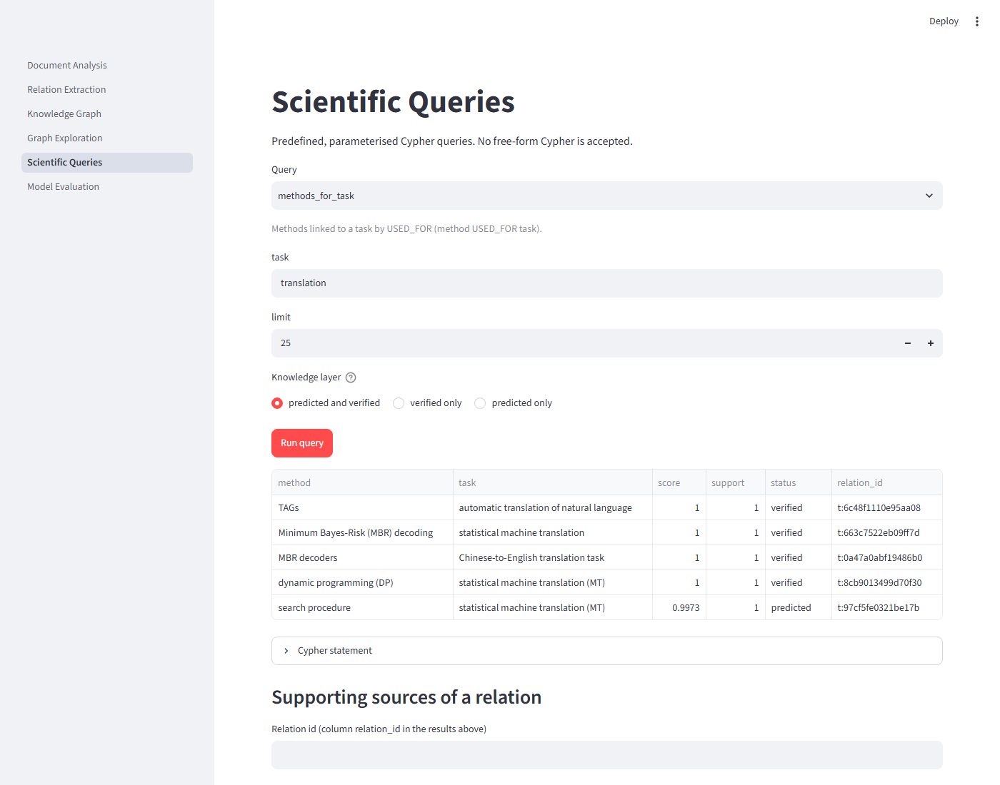 | 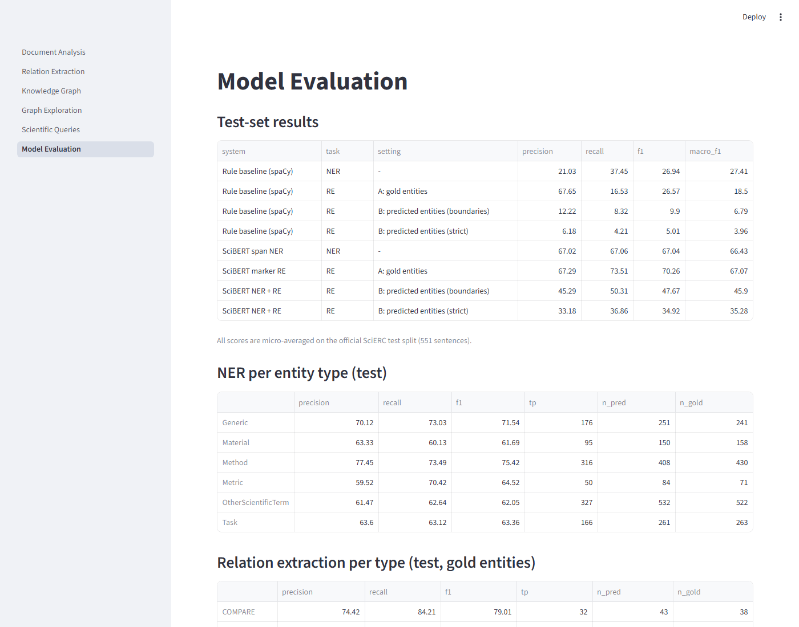 |

With Docker (not tested on the development machine, which has no Docker; the image build
runs in CI):

```bash
docker compose up --build
```

## 18. Reproducibility

* Official SciERC splits, archive checksum recorded; preparation is deterministic.
* Seeds for Python, NumPy and PyTorch; per-epoch shuffling and negative sampling are seeded
  by epoch, so a resumed run sees the same batches as an uninterrupted one.
* Every run writes its parameters (`params.json`), a JSON-lines log, predictions for dev and
  test, and `metrics.json`; `scripts/make_report.py` derives all tables and figures from
  these files.
* Tests: `pytest` (unit tests need no network or GPU; Neo4j tests run with
  `SCIGRAPH_NEO4J_TESTS=1` against a disposable instance, as in CI).

```bash
.venv/Scripts/python -m pytest
```

```bash
.venv/Scripts/python -m ruff check src scripts tests app
```

## 19. Limitations

* Single training run per model (seed 42) on CPU with a reduced configuration; no variance
  estimate and no hyperparameter search.
* SciERC covers 500 AI abstracts; behaviour on other domains or on full papers is not
  measured.
* Relations are intra-sentence; there is no coreference resolution, so Generic mentions
  ("this approach") are isolated nodes.
* Entity resolution is lexical; synonyms with unrelated surface forms are not merged, and
  cross-document acronyms without a definition are not expanded.
* PDF support covers text-layer PDFs only; tables, figures, equations and scanned pages are
  not processed.
* Graph quality is measured against SciERC gold annotations; there is no manual
  evaluation on new documents.

## 20. Future Work

* Run the GPU configuration and a multi-seed study; ablations (BERT-base, no context, no
  markers).
* Coreference resolution and cross-sentence relations (SciIE, DyGIE++ style).
* Entity linking to external identifiers (Wikidata, Papers with Code).
* Use reviewed edges from the review queue as additional training data.
* Calibrate confidence scores so that extraction thresholds are interpretable.

## 21. References

* Y. Luan, L. He, M. Ostendorf, H. Hajishirzi. Multi-Task Identification of Entities,
  Relations, and Coreference for Scientific Knowledge Graph Construction. EMNLP 2018.
* I. Beltagy, K. Lo, A. Cohan. SciBERT: A Pretrained Language Model for Scientific Text.
  EMNLP-IJCNLP 2019.
* Z. Zhong, D. Chen. A Frustratingly Easy Approach for Entity and Relation Extraction.
  NAACL 2021.
* K. Lee, L. He, M. Lewis, L. Zettlemoyer. End-to-end Neural Coreference Resolution.
  EMNLP 2017 (span representations).
* D. Wadden, U. Wennberg, Y. Luan, H. Hajishirzi. Entity, Relation, and Event Extraction with
  Contextualized Span Representations. EMNLP-IJCNLP 2019.
* B. Taillé, V. Guigue, G. Scoutheeten, P. Gallinari. Let's Stop Incorrect Comparisons in
  End-to-end Relation Extraction! EMNLP 2020.
* W3C. RDF 1.1 Concepts; OWL 2 Web Ontology Language; SHACL Shapes Constraint Language.

## Licence

Code: MIT (see `LICENSE`). SciERC is not included; see [docs/DATASET.md](docs/DATASET.md).
