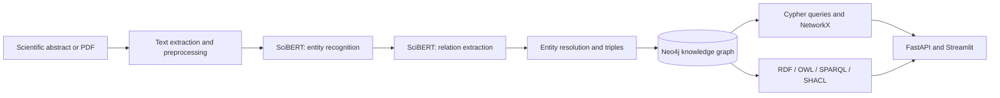
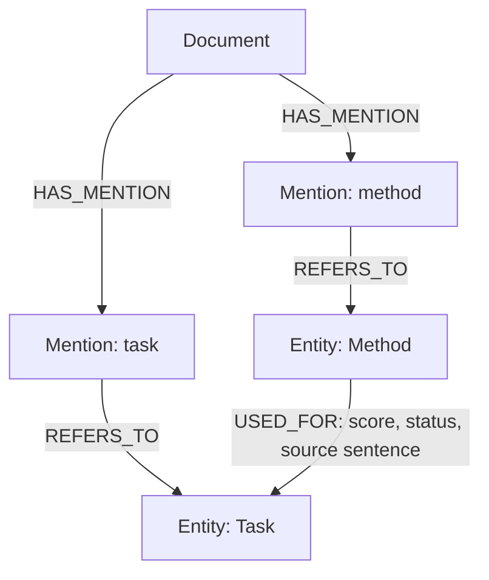

# SciGraph-NLP

**Extracting scientific knowledge from text, one relation at a time.**

I built SciGraph-NLP to explore a question that kept coming up while I was working with scientific papers: *how can I move beyond finding information in an abstract and actually connect it to the rest of the literature?*

The project takes scientific text, identifies entities and relations with fine-tuned SciBERT models, and turns the predictions into a knowledge graph in Neo4j. I wanted the graph to be more than a collection of nodes and edges, so each extracted relation also keeps the sentence it came from, its confidence score, the model version, and its review status.

The repository includes the NLP pipeline, graph construction and exploration tools, a FastAPI service, and a Streamlit application for working with the results.


## What I built

The project has four main parts:

1. **Scientific information extraction.** I fine-tuned SciBERT for named entity recognition (NER) and relation extraction on the SciERC dataset.
2. **Entity resolution and graph construction.** I normalise entity mentions, resolve document-level acronyms, form subject–relation–object triples, and store them in Neo4j with their supporting evidence.
3. **Knowledge representation and exploration.** I added Cypher queries, graph analytics with NetworkX, an RDF/OWL representation, SPARQL queries, and SHACL validation.
4. **An interface for inspecting the results.** The API and Streamlit app let me analyse a document, inspect extracted relations, explore the graph, trace a fact to its source, and examine evaluation results.

### Results at a glance

| Evaluation | Result | What it measures |
|---|---:|---|
| Named entity recognition | **67.04% micro-F1** | Exact span and entity type on the SciERC test set |
| Relation extraction | **70.26% micro-F1** | Relation classification using reference (gold) entities |
| End-to-end relation extraction | **47.67% micro-F1** | Correct relation and entity boundaries using predicted entities |
| End-to-end relation extraction, strict | **34.92% micro-F1** | Correct boundaries, relation, and entity types |
| Knowledge graph | **1,073 predicted triples** | Graph built from the 100 test abstracts |
| Evidence coverage | **100%** | Predicted triples associated with a source sentence |

These figures come from the saved experiment outputs in [`reports/metrics/`](reports/metrics/). I keep the gold-entity and end-to-end results separate because they answer different questions.

## From an abstract to a knowledge graph

The process starts with a scientific abstract or a PDF containing selectable text. After sentence splitting and token alignment, the two SciBERT models identify entities and classify relations. I then normalise mentions, create triples, preserve their evidence, and load the result into Neo4j.



For example, a `USED-FOR` relation connects a scientific method to the task it addresses. The graph can then answer questions such as *which methods are used for this task?* or *which paper supports this connection?*

The latter matters to me as much as the former: without provenance, a predicted edge is difficult to interpret or review.

### How I represent a fact



In Neo4j, relations carry information such as the document, sentence, confidence, support count, model version, and status.

I distinguish **predicted**, **verified**, and **inferred** knowledge rather than treating every graph connection as equally established. Any new inference is labelled separately from the facts used to produce it.

## The dataset and the models

I used [SciERC](https://nlp.cs.washington.edu/sciIE/), a corpus of 500 research abstracts annotated with scientific entities and relations. I kept the official train, development, and test splits.

| Split | Abstracts | Sentences | Entities | Relations |
|---|---:|---:|---:|---:|
| Train | 350 | 1,861 | 5,598 | 3,219 |
| Development | 50 | 275 | 811 | 455 |
| Test | 100 | 551 | 1,685 | 974 |

The entity labels are `Task`, `Method`, `Metric`, `Material`, `OtherScientificTerm`, and `Generic`.

The relation labels are `USED-FOR`, `FEATURE-OF`, `HYPONYM-OF`, `PART-OF`, `COMPARE`, `CONJUNCTION`, and `EVALUATE-FOR`.

### 1. Named entity recognition

Instead of using a conventional BIO tagger, I treated NER as **span classification**.

This allowed me to represent nested entities: the model considers spans of up to eight words and predicts an entity type or a non-entity label.

I used `allenai/scibert_scivocab_uncased` as the encoder and an MLP classifier over the span representation.

Character offsets and WordPiece alignment are preserved so that extracted entities can be traced back to their source text.

**NER results — exact span and type**

| Model | Precision | Recall | Micro-F1 |
|---|---:|---:|---:|
| Rule-based baseline | 21.03% | 37.45% | 26.94% |
| Fine-tuned SciBERT | **67.02%** | **67.06%** | **67.04%** |


### 2. Relation extraction

For relation extraction, I used a second SciBERT model.

It reads a sentence with typed markers around the candidate subject and object, then predicts one of the seven relation classes or `NO-RELATION`.

For example, the input makes the entity roles explicit:

```text
[S:Method] conditional random field [/S:Method]
...
[O:Task] named entity recognition [/O:Task]
```

I evaluated the relation classifier in two settings.

First, I provided the reference entities to measure relation classification on its own.

Then I ran it on the entities predicted by the NER model to evaluate the complete extraction pipeline.

| Setting | Precision | Recall | Micro-F1 |
|---|---:|---:|---:|
| Rule baseline, reference entities | 67.65% | 16.53% | 26.57% |
| SciBERT, reference entities | **67.29%** | **73.51%** | **70.26%** |
| SciBERT pipeline, predicted entities (boundaries) | 45.29% | 50.31% | **47.67%** |
| SciBERT pipeline, predicted entities (strict) | 33.18% | 36.86% | **34.92%** |


This comparison was useful: it showed me exactly why a strong relation classifier does not automatically give the same result when deployed after an entity recogniser.

I used both evaluations when analysing the graph built from model predictions.

### Training curves

The training logs and checkpoints are saved with the experiment outputs.

These are the curves generated from the recorded runs:

| Entity recognition | Relation extraction |
|---|---|
|  |  |

## Building and exploring the graph

After extraction, I normalise surface forms, resolve acronyms defined within a document, and merge mentions only when they satisfy the project's entity matching rules.

Every resulting triple retains the evidence needed to inspect it later.

The graph is organised around `Document`, `Mention`, and `Entity` nodes.

Named relation types connect the entities, while provenance links allow a query result to be traced back to the original document and sentence.

### Graph construction on the test set

| Measure | Value |
|---|---:|
| Documents | 100 |
| Predicted entity nodes | 1,517 |
| Predicted triples | 1,073 |
| Triples with a supporting sentence | 100% |
| SHACL constraint violations | 0 |

This is the **predicted graph**, not the manually annotated reference graph. The two are evaluated separately in `scripts/evaluate_graph.py`.

### Graph queries and analysis

I implemented named, parameterised Cypher queries rather than unrestricted text-to-query generation.

They cover entity search, neighbours, scientific methods associated with a task, relation evidence, and paths of up to five hops.

The NetworkX module adds centrality measures, connected components, community detection, and link hypotheses.

One query I find especially useful is `methods_for_task`:

```cypher
MATCH (m:Entity {type: 'Method'})-[r:USED_FOR]->(t:Entity {type: 'Task'})
WHERE toLower(t.name) CONTAINS toLower($task)
  AND r.status IN $statuses
RETURN m.name AS method,
       t.name AS task,
       r.score AS score,
       r.support AS support
ORDER BY r.support DESC, r.score DESC
LIMIT $limit
```

I also implemented RDF export using RDFLib.

An RDF/OWL vocabulary describes the entity types and scientific relations, SPARQL provides standardised queries, and SHACL checks the structure and provenance of exported assertions.

## Application walkthrough

I built a Streamlit interface to work with the project without having to inspect intermediate JSON files manually.

The six pages cover document analysis, relation extraction, knowledge graph visualisation, graph exploration, scientific queries, and model evaluation.

### Extracted text and relations

| Document analysis | Relation extraction |
|---|---|
|  |  |

### Exploring the knowledge graph

| Knowledge graph | Graph exploration |
|---|---|
|  |  |

### Querying and inspecting evaluation results

| Scientific queries | Model evaluation |
|---|---|
|  |  |

The screenshots were captured from the application using the saved model outputs and the demonstration graph.

They are included to show the workflow, from selecting a document to inspecting a relation and the sentence that supports it.

## Repository structure

```text
src/scigraph/
  data/          Dataset preparation and validation
  baseline/      Rule-based extraction
  models/        SciBERT NER and relation classifiers
  training/      Training and checkpoints
  evaluation/    Model and graph evaluation
  pipeline/      Text/PDF processing and graph creation
  graph/         Neo4j, Cypher, RDF, inference, analytics
  api/           FastAPI endpoints
  resources/     Ontology and SHACL shapes
app/             Streamlit interface
configs/         Model and graph configurations
docs/            Data notes and application screenshots
reports/         Saved metrics and figures
scripts/         Experiment and reporting scripts
tests/           Unit and integration tests
```

## Getting started

Use Python 3.11 and a running Neo4j 5 instance.

The repository includes an `.env.example` file for the Neo4j connection settings.

```bash
python -m venv .venv
```

On Windows PowerShell:

```powershell
.venv\Scripts\Activate.ps1
```

Install the project dependencies:

```bash
python -m pip install -e ".[ui,shacl,dev]"
python -m spacy download en_core_web_sm
```

On Linux or macOS, activate the environment with `source .venv/bin/activate` instead.

Download and prepare SciERC with the provided scripts:

```bash
python scripts/download_scierc.py --out data/raw/scierc
python scripts/prepare_data.py
```

The dataset is downloaded from its source; it is not redistributed in this repository.

See [`docs/DATASET.md`](docs/DATASET.md) for the dataset notes.

Training and evaluation entry points live in `src/scigraph/training/` and `scripts/`, with configurations in `configs/`.

For inference, set up the saved NER and relation model directories as described in [`PROJECT_GUIDE.md`](PROJECT_GUIDE.md).

Start the API or the interactive application:

```bash
python -m uvicorn scigraph.api.main:app --port 8000
```

```bash
python -m streamlit run app/streamlit_app.py
```

The API documentation is available at `http://localhost:8000/docs`.

A few CLI commands I use while working with the graph:

```bash
scigraph extract data/samples/abstract_1.txt --out extraction.json
scigraph ingest data/samples
scigraph export-ttl graph.ttl
```

## Reproducing the experiments

Each training run records its configuration, predictions, metrics, and checkpoints.

The evaluation scripts and saved reports make it possible to check the figures in this README against the recorded outputs.

The evaluation uses the official SciERC test split, with checkpoint selection based on the development split.

- Model metrics and graph reports: [`reports/metrics/`](reports/metrics/)
- Figures: [`reports/figures/`](reports/figures/)
- Evaluation scripts: [`scripts/`](scripts/)
- Test suite: `python -m pytest`
- Code checks: `python -m ruff check src scripts tests app`

## What I took from this project

The most valuable part for me was connecting the modelling work to a system that can actually be inspected.

Predicting an entity or relation is one step; representing that prediction consistently, retaining its evidence, and making it possible to query or review it are separate engineering problems.

Building SciGraph-NLP gave me experience across all of them, from model training to knowledge representation and the application layer.

I am particularly interested in continuing this work around semantic matching, entity linking, and connecting extracted knowledge to shared vocabularies and ontologies.

## References

- Luan et al. (2018), *Multi-Task Identification of Entities, Relations, and Coreference for Scientific Knowledge Graph Construction*.
- Beltagy, Lo, and Cohan (2019), *SciBERT: A Pretrained Language Model for Scientific Text*.
- Zhong and Chen (2021), *A Frustratingly Easy Approach for Entity and Relation Extraction*.
- W3C specifications for RDF, OWL, SPARQL, and SHACL.
